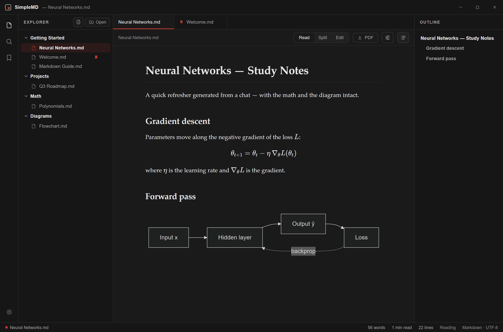
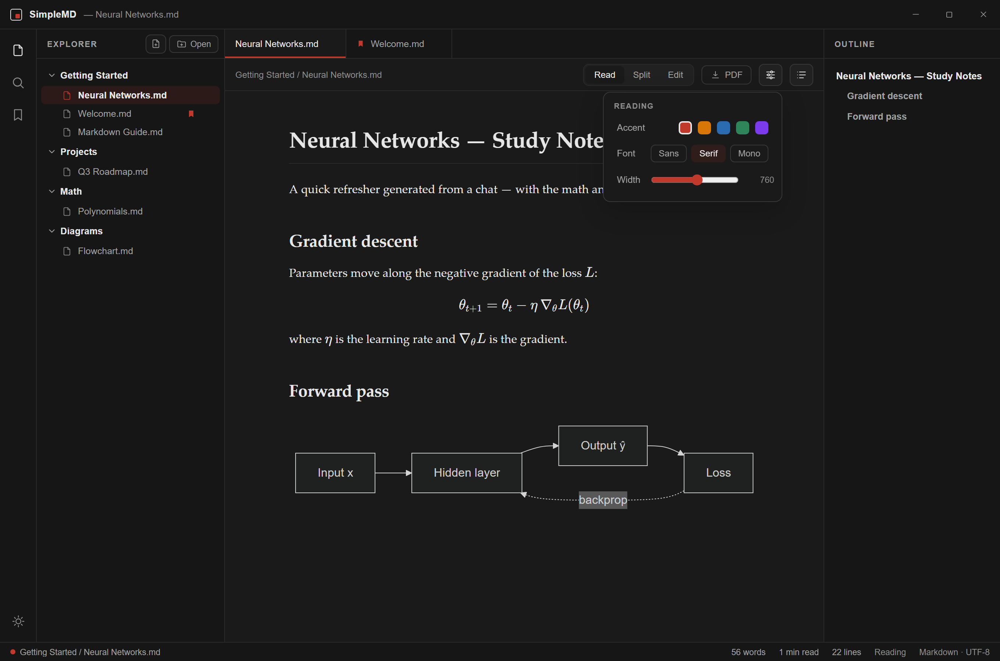

<div align="center">

# SimpleMD

**A fast, private desktop Markdown reader for the age of AI.**

Math, diagrams and code from AI tools, rendered the way they were meant to look. Fully local, no account, no telemetry.

[](https://github.com/njaske/SimpleMD/actions/workflows/ci.yml)
[](https://github.com/njaske/SimpleMD/releases/latest)
[](LICENSE)


[**Download**](https://github.com/njaske/SimpleMD/releases/latest) · [Website](https://njaske.github.io/SimpleMD/) · [Report a bug](https://github.com/njaske/SimpleMD/issues/new/choose)



</div>

## Why

Every AI assistant hands you Markdown: notes, specs, math, diagrams, code. Most Markdown readers were built for plain prose. They mangle LaTeX, ignore Mermaid, and turn technical documents into a wall of raw `$…$` and code fences. SimpleMD renders all of it inline, in a desktop app that keeps your files on your machine.

## Features

**Reads technical Markdown properly**
- KaTeX math, inline `$…$` and display `$$…$$`
- Mermaid diagrams: flowcharts, sequence diagrams and more
- Syntax-highlighted code blocks, tables, task lists

**A real editor, not just a viewer**
- CodeMirror 6 source editor with find/replace
- Read, Split and Edit modes
- Live outline and full-text search across open files

**Safe with files from anyone**
- DOMPurify sanitization of every rendered document
- Sandboxed, context-isolated renderer with a strict Content-Security-Policy
- File access is limited to the folders and files you open; local images stay inside them, and network (UNC) paths are refused
- Atomic saves: a crash mid-write cannot truncate your file

**Private by default**
- No accounts, no telemetry, works offline

**And the essentials**
- Open a folder or individual files, drag and drop
- Export to PDF
- Light and dark themes, adjustable reading font and width



## Install (Windows 10/11, 64-bit)

Download from the [latest release](https://github.com/njaske/SimpleMD/releases/latest):

| File | What it is |
|---|---|
| `SimpleMD-Setup.exe` | Installer (per-user, no admin needed) |
| `SimpleMD-portable.exe` | Single executable, no install |
| `SHA256SUMS.txt` | Checksums for both files |

### Verify your download

Compare the checksum with the one in `SHA256SUMS.txt`:

```powershell
certutil -hashfile SimpleMD-Setup.exe SHA256
```

Each release's notes link to its **VirusTotal** scan report. A VirusTotal result is a useful second opinion, not a guarantee; the source is right here, and you can build it yourself (below).

### About the SmartScreen warning

SimpleMD is free and not code-signed, because signing certificates cost money this project does not spend. Windows shows **"Windows protected your PC"** for unsigned apps that have not yet built download reputation. Click **More info → Run anyway** to continue.

## Build from source

Requires Node.js 22 or newer.

```bash
git clone https://github.com/njaske/SimpleMD.git
cd SimpleMD
npm ci
npm run dev        # run with hot reload
npm test           # unit tests
npm run dist:win   # build installer + portable exe into dist/
```

`sample-notes/` holds demo documents (math, diagrams, tables). Open it from the app with **Open folder**.

Pushing a `v*` tag runs the [release workflow](.github/workflows/release.yml), which builds on GitHub's runners, creates a **draft** release and attaches `SHA256SUMS.txt`.

## Security

See [SECURITY.md](SECURITY.md) for the threat model and how to report a vulnerability privately.

## Built with

[Electron](https://electronjs.org) · [React](https://react.dev) · [CodeMirror 6](https://codemirror.net) · [KaTeX](https://katex.org) · [Mermaid](https://mermaid.js.org) · [marked](https://marked.js.org) + [DOMPurify](https://github.com/cure53/DOMPurify)

## Contributing

Issues and pull requests are welcome. Please run `npm run typecheck && npm test` before opening a PR.

## License

[MIT](LICENSE) © 2026 njaske
