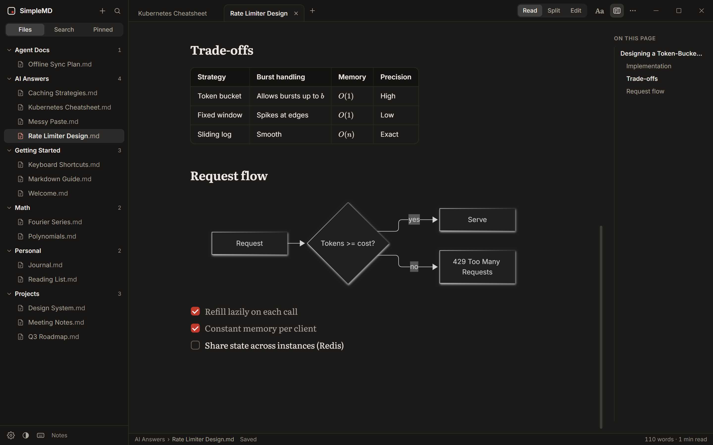
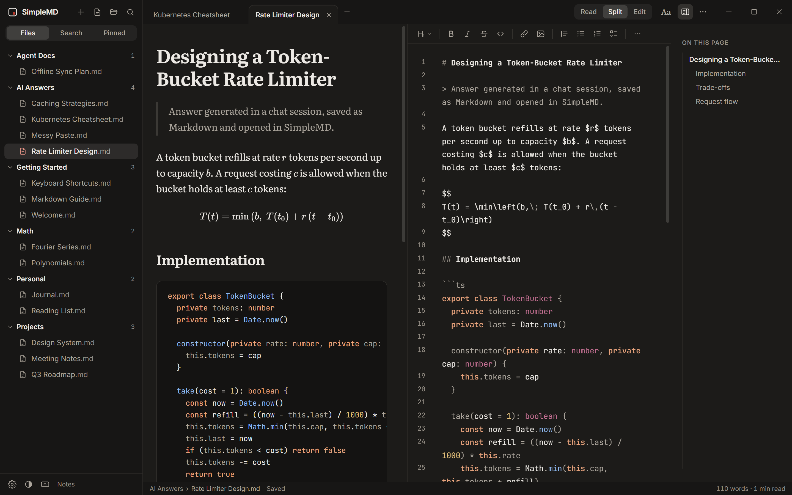
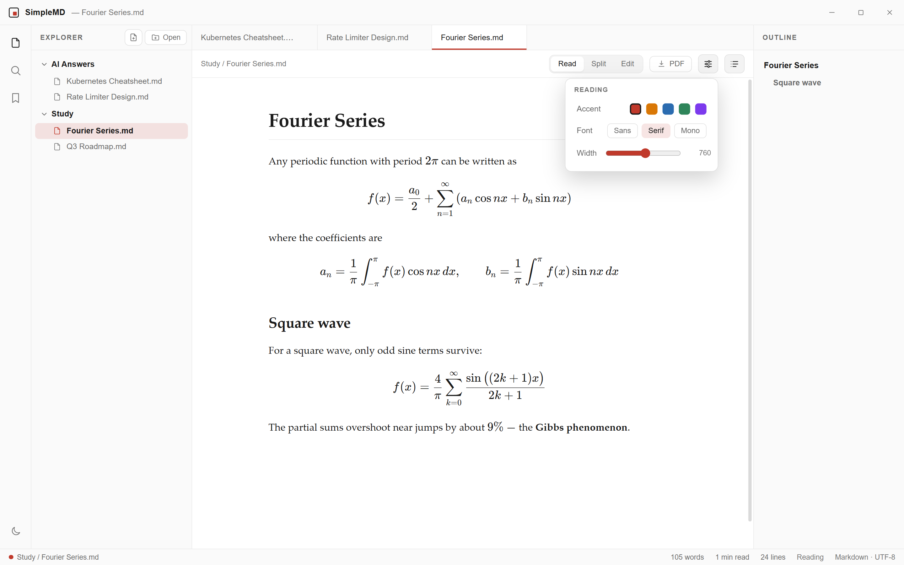

<div align="center">


# SimpleMD

### The desktop reader for everything your AI writes.

Equations come out typeset. Mermaid blocks become real diagrams. Code gets highlighted.<br>
And your files never leave your machine.

[](https://github.com/njaske/SimpleMD/releases/latest)
&nbsp;
[](https://njaske.github.io/SimpleMD/)

[](https://github.com/njaske/SimpleMD/actions/workflows/ci.yml)
[](https://github.com/njaske/SimpleMD/releases/latest)
[-0%2F66-2EA44F?logo=virustotal&logoColor=white)](https://www.virustotal.com/gui/file/0341bfcdad23c339ceb3673897a5ac1cc24ce42972aaf15cd72bf0c9b447abcd)
[-0%2F66-2EA44F?logo=virustotal&logoColor=white)](https://www.virustotal.com/gui/file/4213d0606470a5ee208d582a61a7e8ee992334b0be5c15ae676b026b549386ab)
[](LICENSE)

<br>

https://github.com/user-attachments/assets/02a71b69-d514-4261-a893-f26fdf6c8c65

<sub>Also on <a href="https://njaske.github.io/SimpleMD/#watch">the website</a>, in 60 fps.</sub>

<br><br>


</div>

<br>

## Why SimpleMD

ChatGPT, Claude, Copilot and every other assistant answer in Markdown, full of LaTeX math, Mermaid diagrams and code. Save that answer to a `.md` file, open it in a normal Markdown viewer, and you get a wall of `$$\frac{…}{…}$$` and raw code fences.

SimpleMD renders all of it the way it was meant to look, in a fast desktop app that never uploads your files. No account, no telemetry, no cloud. Open a file or a whole folder and read.

<br>

## See it

<table>
  <tr>
    <td width="50%" valign="top">
      <br>
      <b>Diagrams and tables.</b> Mermaid flowcharts, sequence diagrams, tables with inline math and task lists, all rendered inline.
    </td>
    <td width="50%" valign="top">
      <br>
      <b>Split view.</b> Edit the source on the left, watch the preview follow as you type. Ctrl+S saves.
    </td>
  </tr>
  <tr>
    <td width="50%" valign="top">
      <br>
      <b>Search everything.</b> Find any word across every file in the folder you opened, with each match in context.
    </td>
    <td width="50%" valign="top">
      <br>
      <b>Light or dark.</b> One shortcut (Ctrl+Shift+D). Pick Sans, Serif or Mono, set the reading width and accent colour.
    </td>
  </tr>
</table>

<br>

## Features

| | |
|---|---|
| **Math** | Inline `$…$` and `\(…\)`, display `$$…$$`, `\[…\]` and ` ```math ` blocks, the way ChatGPT and Claude write them, typeset by KaTeX |
| **Diagrams** | Mermaid flowcharts, sequence, class, state and more, drawn as crisp vectors that follow your theme |
| **Rich Markdown** | GitHub alerts and Obsidian callouts, footnotes, front matter shown as a tidy properties card, task lists you can tick (the file is updated), tables, highlighted code |
| **Forgiving** | Common breakage in AI output (an unclosed code fence, a table missing its divider row, curly quotes in a diagram) is repaired for display, never in your file |
| **Made for AI work** | Paste a chat answer as a new document in one keystroke. When an agent edits an open file, SimpleMD highlights what changed and can follow a file as it grows. New files get a dot; `AGENTS.md`, `CLAUDE.md` and friends get their own group |
| **Reading** | Bundled Literata, Inter, JetBrains Mono and Atkinson Hyperlegible, so text looks the same on every computer. Light, dark, sepia or follow the system; text size, line height, width, accent colour, interface scale; focus mode |
| **Editing** | CodeMirror 6 with a formatting bar, Markdown shortcuts, smart paste (web pages, Word and Excel become Markdown and tables), pasted or dropped images saved next to the document, and synced scrolling in Split view |
| **Files** | New document, Save As, rename, duplicate, new file and folder, move to the Recycle Bin. Open a whole folder or single files, or drag and drop. Changes on disk reload automatically, and unsaved work survives a crash |
| **Navigation** | Command palette, Quick Open, find in document, search across files, outline that follows your reading, pinned and recent files, tabs |
| **Export** | PDF, a single self-contained HTML file, print, or copy as rich text to paste into Docs, Word or email |
| **Windows integration** | Shows up in Explorer's "Open with" for `.md`, `.markdown`, `.mdx` and friends; double-click to open |
| **Privacy** | No account, no telemetry, no update checks. The app never phones home; the only thing it ever fetches is an image a document itself links to on the web, and you can block those too |

### Keyboard shortcuts

On macOS use `Cmd` where this says `Ctrl`. Press `Ctrl` `/` in the app for the full list.

| Action | Shortcut |
|---|---|
| Command palette | `Ctrl` `K` |
| Quick Open | `Ctrl` `P` |
| New document / paste from AI | `Ctrl` `N` / `Ctrl` `Shift` `V` |
| Save / Save as | `Ctrl` `S` / `Ctrl` `Shift` `S` |
| Read / Split / Edit | `Ctrl` `1` / `Ctrl` `2` / `Ctrl` `3` |
| Find in document / search all files | `Ctrl` `F` / `Ctrl` `Shift` `F` |
| Close tab / reopen closed tab | `Ctrl` `W` / `Ctrl` `Shift` `T` |
| Toggle sidebar / outline | `Ctrl` `B` / `Ctrl` `\` |
| Focus mode | `Ctrl` `.` |
| Export to PDF | `Ctrl` `Shift` `E` |
| Settings | `Ctrl` `,` |

<br>

## Download

Grab the [latest release](https://github.com/njaske/SimpleMD/releases/latest). Windows 10 and 11, 64-bit. From 1.1 the release workflow also builds macOS (Intel and Apple Silicon) and Linux (AppImage, `.deb`, `.rpm`) packages.

| File | Best for |
|---|---|
| **`SimpleMD-Setup.exe`** | Most people. Installs for your user only (no admin), adds Start Menu and desktop shortcuts and an uninstaller, and registers SimpleMD for "Open with" |
| **`SimpleMD-portable.exe`** | USB sticks and locked-down PCs. One file, nothing to install |
| `SHA256SUMS.txt` | Checksums to verify either download |

### Scanned clean

Every release is uploaded to VirusTotal. For **v1.1.0**, not one of 66 antivirus engines flagged either file.

| File | Result | SHA-256 |
|---|---|---|
| `SimpleMD-Setup.exe` | [**0 / 66 detections**](https://www.virustotal.com/gui/file/0341bfcdad23c339ceb3673897a5ac1cc24ce42972aaf15cd72bf0c9b447abcd) | `0341bfcdad23c339ceb3673897a5ac1cc24ce42972aaf15cd72bf0c9b447abcd` |
| `SimpleMD-portable.exe` | [**0 / 66 detections**](https://www.virustotal.com/gui/file/4213d0606470a5ee208d582a61a7e8ee992334b0be5c15ae676b026b549386ab) | `4213d0606470a5ee208d582a61a7e8ee992334b0be5c15ae676b026b549386ab` |

To check that your download is the exact file that was scanned, compare its hash with the table above:

```powershell
certutil -hashfile SimpleMD-Setup.exe SHA256
```

### "Windows protected your PC"

SimpleMD isn't code-signed (certificates cost money this free project doesn't spend), so SmartScreen warns about it until it builds download reputation. Click **More info**, then **Run anyway**. If you'd rather not, every line of the source is here and you can [build it yourself](#build-from-source).

<br>

## Safe with files from anyone

A Markdown file is just text, but a careless viewer can be tricked into running code from it. SimpleMD treats every document as untrusted:

- **Sanitized rendering.** Every document passes through DOMPurify. Scripts, event handlers, iframes, forms, media and style tricks like full-screen overlays are stripped before anything reaches the page.
- **Sandboxed window.** The renderer runs sandboxed and context-isolated, with no Node.js access and a strict Content-Security-Policy that allows only the app's own code.
- **File access you control.** The app can only read the folders and files you opened. Local images can't be read from outside them, and network (UNC) paths are refused.
- **Hardened binary.** Electron fuses disable running as plain Node, `NODE_OPTIONS` and debugger injection, and the app only loads its integrity-checked bundle.
- **Safe saves.** Writes go to a temporary file that replaces the original in one step, so a crash can't leave you with half a file.

Full details and how to report a vulnerability privately: [SECURITY.md](SECURITY.md).

<br>

## Build from source

Requires [Node.js](https://nodejs.org) 22.15 or newer.

```bash
git clone https://github.com/njaske/SimpleMD.git
cd SimpleMD
npm ci
npm run dev        # run with hot reload
npm test           # unit tests
npm run test:e2e   # end-to-end tests that drive the built app
npm run dist:win   # build the installer and portable exe into dist/
```

Try it on the demo documents in [`sample-notes/`](sample-notes) (math, diagrams, tables, an AI-style design doc) with **Open folder**.

Releases are built by [GitHub Actions](.github/workflows/release.yml) from the tagged source, never on a personal machine, and published with their checksums.

<br>

## Disclaimer

SimpleMD is a free, independent, open-source hobby project, provided **"as is", without warranty of any kind**, under the [MIT License](LICENSE).

- **Scans are a second opinion, not a guarantee.** The VirusTotal results above apply only to the exact files and hashes listed. Download only from this repository's [Releases page](https://github.com/njaske/SimpleMD/releases), and verify the hash.
- **No software is perfectly secure.** SimpleMD takes care to render untrusted documents safely (see above), but you open files at your own risk. Please [report](SECURITY.md) anything that looks wrong.
- **SimpleMD shows content; it doesn't check it.** It renders whatever is in the file. It does not verify that AI-generated text, math or code is correct.
- **Not affiliated** with VirusTotal, Microsoft, OpenAI, Anthropic, GitHub or any other company mentioned here. Names and trademarks belong to their owners.

<br>

## Built with

[Electron](https://electronjs.org) · [React](https://react.dev) · [CodeMirror 6](https://codemirror.net) · [KaTeX](https://katex.org) · [Mermaid](https://mermaid.js.org) · [marked](https://marked.js.org) · [DOMPurify](https://github.com/cure53/DOMPurify) · [highlight.js](https://highlightjs.org)

## Contributing

Issues and pull requests are welcome. Please run `npm run typecheck && npm test` before opening a PR. Found a security issue? Please follow [SECURITY.md](SECURITY.md) instead of opening a public issue.

## License

[MIT](LICENSE) © 2026 njaske
