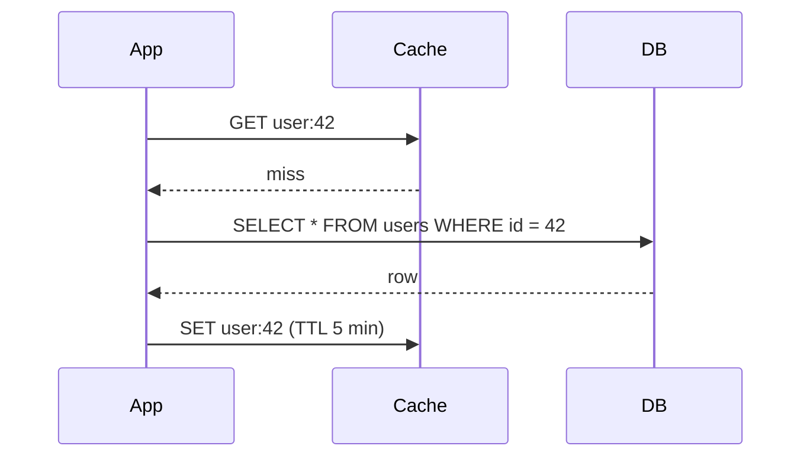

# Caching strategies, explained

> [!NOTE]
> This answer was pasted straight from a chat. SimpleMD renders it as-is: the math, the callouts, the footnotes and the checklist all come from the raw Markdown.

A cache trades memory for latency. How much it helps depends almost entirely on the **hit ratio** \(h\), the share of reads served from the cache. The average time per read is a weighted mix of the two paths:

\[
T_{avg} = h \cdot T_{cache} + (1 - h) \cdot T_{origin}
\]

With a cache hit taking \(T_{cache} = 2\,\text{ms}\) and the database \(T_{origin} = 40\,\text{ms}\), going from \(h = 0.80\) to \(h = 0.95\) cuts the average from 9.6 ms to 3.9 ms. The last few percent of hit ratio matter more than they look.[^tail]

## The four common patterns

| Strategy | How it works | Good for | Main risk |
| --- | --- | --- | --- |
| Cache-aside | The app reads the cache, falls back to the database, then fills the cache | Read-heavy data | Stale reads after writes |
| Read-through | The cache itself loads misses from the database | Simple app code | Cold-start stampedes |
| Write-through | Every write goes to the cache and the database together | Consistency | Slower writes |
| Write-back | Writes land in the cache and flush later | Write bursts | Data loss on a crash |

> [!TIP]
> Start with **cache-aside** and a short TTL. Raise the TTL once you trust your invalidation, not before.

### Cache-aside in practice

```ts
export async function getUser(id: string): Promise<User> {
  const key = `user:${id}`
  const hit = await redis.get(key)
  if (hit) return JSON.parse(hit) as User

  const user = await db.users.findById(id)
  // Jitter spreads expirations so hot keys don't all expire together.
  const ttl = 300 + Math.floor(Math.random() * 60)
  await redis.set(key, JSON.stringify(user), { EX: ttl })
  return user
}
```

The flow for a miss looks like this:



## Invalidation

There are only two hard things in computer science, and cache invalidation is one of them.[^hard] The safest default is to **delete** the key on write rather than update it, so a racing reader can't put an old value back.

> [!WARNING]
> Never cache responses that carry per-user secrets under a shared key. A single bad key turns a cache into a data leak.

> [!faq]- Why delete instead of update on write?
> If two writers update the cache at the same time, the slower one can overwrite the newer value. Deleting forces the next reader to load fresh data from the database, which is always correct.

## Sizing the TTL

For a key that changes on average every \(\tau\) seconds, a TTL of \(t\) gives a staleness probability of roughly

$$
P(\text{stale}) \approx 1 - e^{-t/\tau}
$$

so a TTL of a tenth of \(\tau\) keeps fewer than 10% of reads stale. Prices like $5 for $10 stay plain text, by the way: only real formulas become math.

```math
\text{speedup} = \frac{T_{origin}}{T_{avg}} = \frac{40}{3.9} \approx 10.3\times
```

## Checklist before shipping

- [x] Measure the current hit ratio
- [x] Pick a key scheme (`entity:id`, versioned)
- [ ] Add jitter to every TTL
- [ ] Protect hot keys from stampedes
  - [ ] Request coalescing in the app
  - [ ] Early refresh at 80% of the TTL
- [ ] Alert when the hit ratio drops below 85%

> [!CAUTION]
> Write-back caching can lose acknowledged writes if a node dies before it flushes. Use it only for data you can afford to recompute.

[^tail]: This is why teams chase a 99% hit ratio on hot paths: each miss costs twenty hits.
[^hard]: Phil Karlton's famous line. The other is naming things, and the bonus third is off-by-one errors.
