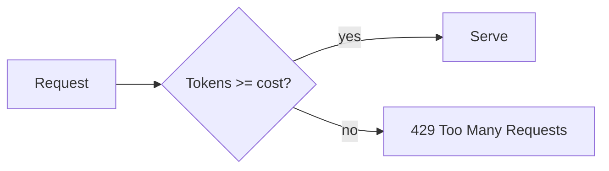

# Designing a Token-Bucket Rate Limiter

> Answer generated in a chat session, saved as Markdown and opened in SimpleMD.

A token bucket refills at rate $r$ tokens per second up to capacity $b$. A request costing $c$ is allowed when the bucket holds at least $c$ tokens:

$$
T(t) = \min\left(b,\; T(t_0) + r\,(t - t_0)\right)
$$

## Implementation

```ts
export class TokenBucket {
  private tokens: number
  private last = Date.now()

  constructor(private rate: number, private cap: number) {
    this.tokens = cap
  }

  take(cost = 1): boolean {
    const now = Date.now()
    const refill = ((now - this.last) / 1000) * this.rate
    this.tokens = Math.min(this.cap, this.tokens + refill)
    this.last = now
    if (this.tokens < cost) return false
    this.tokens -= cost
    return true
  }
}
```

## Trade-offs

| Strategy | Burst handling | Memory | Precision |
|---|---|---|---|
| Token bucket | Allows bursts up to $b$ | $O(1)$ | High |
| Fixed window | Spikes at edges | $O(1)$ | Low |
| Sliding log | Smooth | $O(n)$ | Exact |

## Request flow



- [x] Refill lazily on each call
- [x] Constant memory per client
- [ ] Share state across instances (Redis)
