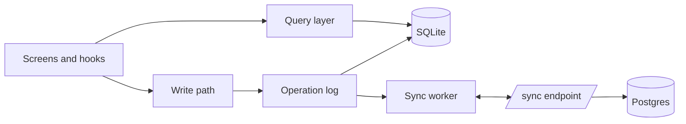

# Offline sync for the notes app

*Implementation plan written by a coding agent after reading the repository. Nothing here has been merged yet.*

> [!IMPORTANT]
> The goal is simple to state: every edit works offline, and two devices that edited the same note converge to the same text without asking the user to pick a winner.

## Summary

The mobile and desktop clients keep a local SQLite database and talk to the server only through a sync endpoint. Each note is stored as a sequence of operations with hybrid logical clock (HLC) timestamps, so merges are deterministic. The plan has four phases and touches 23 files.

| Phase | Scope | Estimate | Risk |
| --- | --- | ---: | --- |
| 1 | Local store and migrations | 3 days | Low |
| 2 | Operation log and HLC | 4 days | Medium |
| 3 | Sync endpoint and transport | 5 days | Medium |
| 4 | Conflict UI and telemetry | 3 days | Low |
| | **Total** | **15 days** | |

## Current state

Today every screen calls the REST API directly. I found 41 call sites across `src/screens` and `src/hooks`; 9 of them write data.

```text
src/
├── api/            REST client (fetch wrapper, retries)
├── hooks/          useNote, useNotes, useTags ...
├── screens/        NoteEditor, NoteList, Search
└── store/          in-memory cache (lost on restart)
```

> [!WARNING]
> `store/cache.ts` mutates objects in place and several hooks rely on that. Phase 1 replaces it, so those hooks need to move to the new query API at the same time.

## Architecture



The query layer is the only thing screens talk to. Writes never go to the network directly: they append operations, and the sync worker ships them when a connection is available.

### Data model

```sql
CREATE TABLE notes (
  id          TEXT PRIMARY KEY,
  title       TEXT NOT NULL DEFAULT '',
  body        TEXT NOT NULL DEFAULT '',
  updated_hlc TEXT NOT NULL,
  deleted     INTEGER NOT NULL DEFAULT 0
);

CREATE TABLE ops (
  hlc      TEXT PRIMARY KEY,   -- "<wall ms>:<counter>:<device>"
  note_id  TEXT NOT NULL REFERENCES notes(id),
  kind     TEXT NOT NULL CHECK (kind IN ('insert', 'delete', 'set_title')),
  payload  TEXT NOT NULL,
  synced   INTEGER NOT NULL DEFAULT 0
);

CREATE INDEX ops_unsynced ON ops(synced) WHERE synced = 0;
```

### Hybrid logical clocks

An HLC timestamp is a pair \((l, c)\) of the largest wall-clock time seen so far and a counter. On a local event the clock moves to

\[
l' = \max(l, \text{now}), \qquad c' = \begin{cases} c + 1 & \text{if } l' = l \\ 0 & \text{otherwise} \end{cases}
\]

and on receiving a remote timestamp \((l_m, c_m)\) it takes the maximum of all three wall times. Ties are broken by device id, which gives a total order that every device agrees on.[^hlc]

```ts
export interface Hlc {
  wall: number
  counter: number
  device: string
}

export function tick(clock: Hlc, now: number): Hlc {
  const wall = Math.max(clock.wall, now)
  const counter = wall === clock.wall ? clock.counter + 1 : 0
  return { ...clock, wall, counter }
}

export function compare(a: Hlc, b: Hlc): number {
  return a.wall - b.wall || a.counter - b.counter || a.device.localeCompare(b.device)
}
```

## Phase 1: local store

1. Add `expo-sqlite` (already used by the image cache, so no new native module).
2. Write migrations as plain SQL files with a version table.
3. Replace `store/cache.ts` with a query layer that returns immutable snapshots.
4. Move the nine write call sites to `notes.apply(op)`.

> [!TIP]
> Keep the REST client during phase 1. Reads come from SQLite, but a background refresh still fills it from the API, so the app keeps working before sync exists.

## Phase 2: operation log

Every write becomes an operation appended to `ops` inside the same transaction that updates `notes`. Text edits are stored as character-level inserts and deletes so concurrent edits interleave instead of overwriting each other.

| Operation | Payload | Example |
| --- | --- | --- |
| `insert` | position id, character | `{"after":"a1:3","ch":"x"}` |
| `delete` | position id | `{"id":"b7:12"}` |
| `set_title` | full title | `{"title":"Groceries"}` |

Titles are short, so last-writer-wins by HLC is good enough there.

> [!faq]- Why not a library like Automerge or Yjs?
> Both would work. They also add 200 to 400 KB to the bundle and their own storage format. The notes are plain text with a title, which is a small enough model to own, and owning it keeps the SQLite rows readable for support and export.

## Phase 3: sync endpoint

The client sends every unsynced operation and the highest server sequence number it has seen. The server stores the operations, assigns sequence numbers, and returns everything newer than the client's cursor.

```http
POST /v1/sync
Content-Type: application/json

{
  "device": "ios-6f2a",
  "cursor": 18233,
  "ops": [{ "hlc": "1760707200000:0:ios-6f2a", "note_id": "n_91", "kind": "insert", "payload": "..." }]
}
```

```python
def sync(device: str, cursor: int, ops: list[Op]) -> SyncResult:
    with db.transaction():
        for op in ops:
            db.ops.insert_ignore(op)          # idempotent: retries are safe
        newer = db.ops.after(cursor, exclude_device=device)
    return SyncResult(cursor=db.ops.max_seq(), ops=newer)
```

Expected payloads are small. With an average edit session of 400 operations at about 90 bytes each, a full upload is roughly 36 KB before compression.

## Phase 4: conflicts and telemetry

Text never conflicts by construction. The only visible conflict is *delete versus edit*: one device deletes a note while another edits it. The plan keeps the edit and shows a quiet banner:

> This note was deleted on another device. Your edits kept it. **Delete it here too** or **Keep it**.

Telemetry counts sync duration, operations per sync and merge time, with no note content.

## Testing

- [x] Property test: random operation orders always converge
- [x] HLC monotonicity under clock skew of ±5 minutes
- [ ] Two simulators editing the same note while offline
- [ ] Kill the app mid-sync, then resume
- [ ] Migration from the current in-memory cache on upgrade
- [ ] Load test: 10,000 notes, first sync under 3 seconds

## Open questions

1. Do we need end-to-end encryption in the first release? It changes the payload format, so deciding late is expensive.
2. Should attachments sync through the same endpoint or a separate upload queue? I lean towards a separate queue.[^attach]
3. How long do we keep tombstones? I propose 90 days, after which a device that has been offline that long does a full resync.

> [!NOTE]
> I haven't changed any code yet. Reply in this file or in the PR and I'll start with phase 1.

[^hlc]: Kulkarni et al., *Logical Physical Clocks and Consistent Snapshots in Globally Distributed Databases*, 2014.
[^attach]: Attachments are large and rarely edited, so mixing them with small text operations would make every sync wait on uploads.
