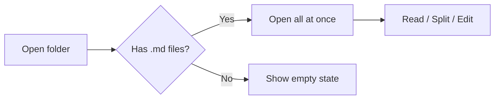

# Markdown Guide

Everything SimpleMD knows how to render, on one page.

## Headings

Use one to six `#` characters. They populate the outline on the right automatically.

## Emphasis

You can write *italic*, **bold**, ***both***, and ~~strikethrough~~ text. Inline `code` sits comfortably inside a sentence.

## Lists

Unordered:

- Coffee
- Tea
  - Green
  - Oolong
- Water

Ordered:

1. Draft
2. Revise
3. Ship

### Task lists

- [x] Render headings
- [x] Render tables
- [ ] Achieve inbox zero

## Quotes

> The details are not the details. They make the design.
>
> — Charles Eames

## Code

Inline `const x = 1` or a fenced block:

```js
// Debounce a function
function debounce(fn, ms = 200) {
  let t;
  return (...args) => {
    clearTimeout(t);
    t = setTimeout(() => fn(...args), ms);
  };
}
```

```python
def fib(n):
    a, b = 0, 1
    for _ in range(n):
        a, b = b, a + b
    return a
```

## Math

Inline math like $E = mc^2$ sits in a sentence, and display blocks stand on their own:

$$ \int_0^1 x^2 \, dx = \frac{1}{3} $$

Powered by KaTeX — use `$...$` for inline and `$$...$$` for blocks.

## Tables

| Feature | Status | Notes |
| --- | --- | --- |
| Tables | Done | GitHub flavored |
| Math | Done | KaTeX |
| Diagrams | Done | Mermaid |

## Diagrams



## Images


## Links

Visit the [CommonMark spec](https://commonmark.org) to go deeper.

---

That is the whole vocabulary. The rest is just writing.
